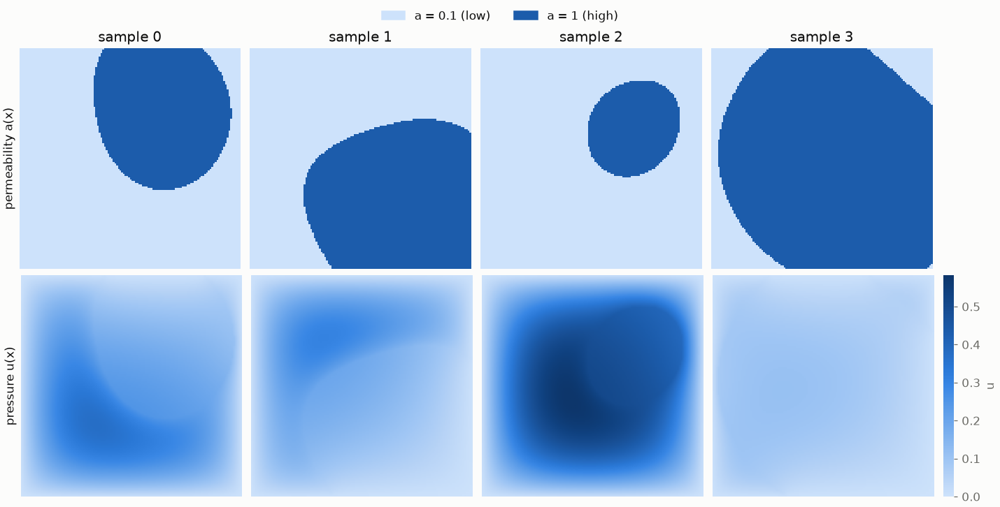
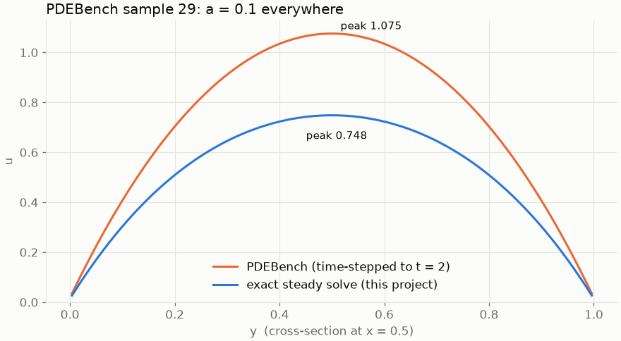

# Building a Darcy-flow dataset for a Fourier Neural Operator

*Part 1 of the FNO Darcy-flow project: generating the training data.*

**Links:** [Code on GitHub](TODO_REPO_URL) · [Dataset notebook on Kaggle](TODO_KAGGLE_NOTEBOOK_01_URL) · [Generated dataset](TODO_KAGGLE_DATASET_URL)

---

## The goal

A Fourier Neural Operator (FNO) learns a map from one *function* to another. Here the input is a
permeability field a(x), which says how easily fluid moves through each point of a porous rock.
The output is the pressure field u(x) that results. Once trained, the FNO predicts u(x) in
milliseconds, while a numerical solver has to solve a large sparse linear system for every new input.

Before the model can learn anything it needs examples: thousands of (a, u) pairs where u is the
correct solution for a. This post covers how those pairs are made, and how I checked them against
a public benchmark.

## The equation

Steady-state Darcy flow on the unit square:

$$
-\nabla \cdot \big( a(x)\, \nabla u(x) \big) = f, \qquad x \in (0,1)^2, \qquad u = 0 \text{ on the boundary}
$$

with a constant source f = 1. Fluid is injected everywhere and drains out through the edges.
Where the rock is permeable (large a) pressure spreads out easily, and where it is tight (small a)
pressure builds up.

## Matching a public benchmark: PDEBench

[PDEBench](https://github.com/pdebench/PDEBench) (Takamoto et al., NeurIPS 2022) is a standard
benchmark for neural PDE solvers. It ships a 2D Darcy dataset: 10,000 samples at 128×128, about
1.3 GB per forcing value. I wanted my own data to sit in **the same setting**. A model trained here
can then be evaluated on PDEBench, or retrained on it, without changing anything else.

So I downloaded PDEBench's `2D_DarcyFlow_beta1.0_Train.hdf5` (checked against its published MD5),
read its generator, and matched every input setting:

| | This project | PDEBench Darcy, β = 1.0 |
|---|---|---|
| Grid | 128 × 128 cell centres | 128 × 128 cell centres |
| Permeability a(x) | 5 random Gaussian bumps, thresholded to {1, 0.1} | same |
| Source f | 1 | 1 |
| Boundary | u = 0 | u = 0 |
| File layout | `nu`, `tensor`, `x-coordinate`, `y-coordinate`, `beta` (HDF5) | same |
| How u(x) is computed | **exact steady-state solve** | time-stepping to t = 2 |

The last row is the one deliberate difference. The rest of this post explains why.

## Step 1: sampling the permeability a(x)

Each permeability field starts as a smooth bump landscape. Pick 5 random centres in the square,
give each a random width, and add up the Gaussians. Then threshold the result: everything above the
mean becomes high permeability (a = 1), everything below becomes low permeability (a = 0.1). This
gives two-phase "rock" with smooth blob-shaped inclusions, a 10× contrast between phases, and very
different geometry from sample to sample.

Following PDEBench, the threshold is the mean over a batch of 200 samples rather than per sample.
Some fields are therefore mostly permeable and some mostly tight, which widens what the model sees.

*Top: a(x), dark = permeable. Bottom: the pressure u(x) it produces. Pressure peaks inside the tight
(light) regions, where fluid can't escape easily.*

## Step 2: solving for u(x)

The PDE is discretised with a standard 5-point **finite-volume** stencil. Each cell exchanges flux
with its four neighbours through faces whose permeability is the average of the two cells. That
gives one sparse linear system with 128 × 128 = 16,384 unknowns per sample, which a sparse LU
factorisation (SciPy's `spsolve`) solves in about 48 ms.

I used PDEBench's own spatial discretisation: grid spacing h = 1/128, arithmetic face averaging, and
the zero boundary one cell outside the edge. The table shows why it matters. I took 64 PDEBench
permeability fields, solved them with three stencils, and measured the relative L2 difference from
PDEBench's stored u(x):

| Stencil | Median difference | Mean | 90th percentile |
|---|---|---|---|
| Harmonic faces, h = 1/(n+1) (textbook) | 1.26 % | 4.19 % | 12.6 % |
| Harmonic faces, h = 1/n | 1.15 % | 3.58 % | 11.3 % |
| **Arithmetic faces, h = 1/n (PDEBench's stencil)** | **0.23 %** | 3.35 % | 12.0 % |

With the matching stencil the median sample agrees to about a quarter of a percent. The method is
the same. What remains is a long tail of samples that differ by 10 % or more.

## A finding: some PDEBench samples haven't reached steady state

PDEBench doesn't solve the steady equation directly. It starts from a *random* initial pressure
field and runs the time-dependent equation u_t = ∇·(a∇u) + f up to t = 2, then stores that final
snapshot as "the" solution. In permeable samples the transient dies out long before t = 2. In tight
samples (small a) diffusion is slow, and the leftover initial condition is still in the data.

The clearest case is a PDEBench sample whose permeability is 0.1 *everywhere*. That is a plain
Poisson problem with a known answer: its peak is 10 × 0.0737 ≈ 0.737 for the continuous problem,
or 0.748 on PDEBench's grid. PDEBench's stored solution peaks at **1.075**, 44 % above the steady value on its own grid:

For a training set this is label noise: the model would be taught pressures that aren't the
solution of the equation. So this project keeps PDEBench's *inputs* and *discretisation* but solves
the steady system exactly. Every u(x) in the generated data is the true steady state of the same
discrete problem.

## How close is the result to PDEBench?

I compared 1,000 generated samples with the first 1,000 PDEBench samples:

| Statistic | PDEBench | Generated |
|---|---|---|
| Share of cells with a = 1 | 0.495 | 0.492 |
| Per-sample share of a = 1 (10th / 50th / 90th percentile) | 0.21 / 0.51 / 0.75 | 0.19 / 0.50 / 0.75 |
| Mean u | 0.159 | 0.152 |
| Mean of each sample's peak u | 0.328 | 0.310 |
| Largest u in any sample | 1.235 | 0.748 |

The permeability fields are statistically the same, and the pressures agree to within about 5 % on
average. The largest gap is in the maximum, and that is the unconverged PDEBench samples from the
previous section. The highest value our steady solve can produce is the all-tight case, 0.748.

## Engineering the generator

The generator is a single self-contained script written out by the
[Kaggle notebook](TODO_KAGGLE_NOTEBOOK_01_URL). It needs only NumPy, SciPy and h5py, and doesn't
clone any repository.

- **Reproducible regardless of hardware.** a(x) is sampled in batches of 200, each from its own
  seeded random generator (`default_rng([seed, batch])`). The dataset is bit-identical whether it
  runs on 1 core or 64.
- **Parallel where it's expensive.** Sampling a(x) is cheap. Solving is not, so solves are sent to
  all CPU cores in small blocks of 8 samples. All workers stay busy until the end.
- **An ETA you can trust.** Before generating, the script times a short probe on the *same worker
  pool*, so slowdown from parallel solves competing for the CPU is included. While running it
  prints progress, throughput and ETA every 2 seconds. On an 8-core laptop, 1,000 samples were
  estimated at 24 s and took 23 s (about 53 samples/s).
- **Held-out splits.** Train, validation and test (9,000 / 500 / 500, 10,000 in total like
  PDEBench) use different seeds, and the notebook checks that no sample appears in two splits.
- **Benchmark-compatible output.** Each split is an HDF5 file in PDEBench's exact layout. The
  training notebook reads either source with one setting:
  `DATA_SOURCE = "generated"` or `DATA_SOURCE = "pdebench"`.

Full run on Kaggle: 10,000 samples in **TODO_KAGGLE_RUNTIME** on TODO_KAGGLE_CPUS CPU cores.

## What's next

Part 2 trains the FNO on this data with distributed data-parallel training on two GPUs. It then
evaluates the model on the held-out test split and on PDEBench's own data, to see how well a
model trained on exact solutions transfers to the benchmark.

## References

- Z. Li et al., *Fourier Neural Operator for Parametric Partial Differential Equations*, ICLR 2021.
- M. Takamoto et al., *PDEBench: An Extensive Benchmark for Scientific Machine Learning*,
  NeurIPS 2022 Datasets and Benchmarks. Data: [DaRUS, doi:10.18419/darus-2986](https://doi.org/10.18419/darus-2986).
  This project reimplements PDEBench's data settings; it does not reuse PDEBench code.
